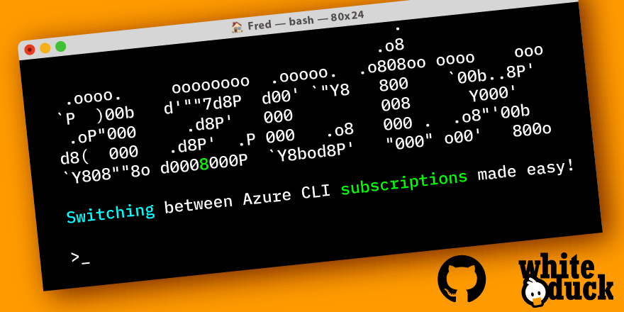
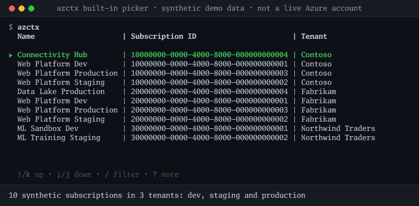

# azctx



[](https://scorecard.dev/viewer/?uri=github.com/whiteducksoftware/azctx)
[](https://github.com/whiteducksoftware/azctx/actions/workflows/ci.yaml)
[](https://github.com/whiteducksoftware/azctx/releases)

**Pick the right Azure subscription quickly, switch back just as fast, and
check the expected context before scripts, pipelines or AI agents run Azure
commands.**

azctx is a context tool for the [Azure CLI](https://learn.microsoft.com/cli/azure/).
It selects subscriptions by fuzzy name, alias, GUID or tenant, returns to the
previous subscription, exports a context to one process and checks a project's
expected tenant and subscription before work starts. Authentication always
stays in Azure CLI; azctx never handles credentials or MSAL token caches.



*Synthetic demo.* The [demo generator](docs/development.md#demo-gif) drives the
real built-in picker with key presses and renders its actual terminal output.
Subscription names, tenants and GUIDs are invented; it is not a recording of a
live Azure account.

## 1. Use cases

Azure CLI 2.61 added a subscription picker during login. azctx adds context
management for the rest of the day:

| You want to | With azctx | With Azure CLI alone |
| --- | --- | --- |
| Switch subscriptions without copying IDs | Fuzzy picker, `azctx prod`, `azctx contoso/prod`, GUIDs | `az account set --subscription <id or exact name>` |
| Tell apart identical names in several tenants | Candidates with tenant names and GUID identities | Exact-name ambiguity |
| Return to the previous subscription | `azctx -` | No built-in shortcut |
| Reach frequent subscriptions by short names | Aliases, pinned and recent subscriptions | No built-in aliases |
| Sign in to many tenants that require MFA | One confirmation to retry only eligible failed tenants | Manual sign-in per failed tenant |
| Change broker sign-in | Explicitly confirmed `azctx auth broker enable` | Clear accounts, change setting, sign in |
| Diagnose a confusing setup | Offline `azctx doctor` | Several commands and files |
| Give Terraform, azd or a pipeline a context | `azctx env`, `azctx exec`, pipeline formats | Set context variables yourself |
| Avoid working in the wrong subscription | `azctx guard`, `.azctx.yaml`, protected switching | Not checked against project expectations |
| Let AI agents use Azure CLI more safely | Skill, JSON errors, input controls, optional Claude Bash hook, history | Shared default can change across terminals |

Guard and protection reduce mistakes. Azure RBAC, PIM and Conditional Access
remain the authorization boundary.

## 2. Install

Prerequisites: Azure CLI **2.61.0+**, macOS **13+** or Windows **10+** where
applicable. macOS broker preview requires Azure CLI **2.91.0+** and enrollment.
Linux binaries support amd64, arm64 and armv6; macOS and Windows support amd64
and arm64. The old 32-bit Windows ARM build is gone.

Check [GitHub releases](https://github.com/whiteducksoftware/azctx/releases)
for the versions actually published; the examples use 2026.11.0. On macOS and
Windows, install with your platform's package manager:

```sh
# macOS, fully qualified cask
brew install --cask whiteducksoftware/tap/azctx
# Windows, Chocolatey
choco install azctx --version=2026.11.0
# Windows, winget
winget install --exact --id whiteducksoftware.azctx --version 2026.11.0
```

On Linux, download the release archive for your architecture,
`azctx_Linux_x86_64.tar.gz` (amd64), `azctx_Linux_arm64.tar.gz` or
`azctx_Linux_armv6.tar.gz`, and the release checksum file. Verify both the
checksum and the attestation before installing. For example, on amd64:

```sh
set -eu
gh release download 2026.11.0 --repo whiteducksoftware/azctx \
  --pattern azctx_Linux_x86_64.tar.gz \
  --pattern azctx_2026.11.0_Darwin_Linux_checksums.txt
grep '  azctx_Linux_x86_64.tar.gz$' azctx_2026.11.0_Darwin_Linux_checksums.txt | sha256sum --check --strict -
gh attestation verify azctx_Linux_x86_64.tar.gz --repo whiteducksoftware/azctx
tar -xzf azctx_Linux_x86_64.tar.gz azctx
mkdir -p "$HOME/.local/bin"
install -m 0755 azctx "$HOME/.local/bin/azctx"
```

Add `$HOME/.local/bin` to PATH if necessary. Stop if verification fails or an
expected attestation is absent.
See [security](docs/security.md#verify-a-release) for macOS/Windows checks,
provenance limits and unsigned macOS binaries. A checksum alone is not an
independent proof of origin.

To build from source, use Go as declared in `go.mod` (minimum 1.26, preferred
1.27.3), review the source and run `make build`. Run the resulting `./azctx`
(`./azctx.exe` on Windows) from the checkout or copy it onto PATH.

## 3. Quickstart

With a reviewed binary and Azure CLI installed:

```sh
azctx login
azctx
azctx prod
azctx -
```

Press `/` to filter, arrows to move, Enter to accept the filter, then Enter to
select. Escape cancels with exit 1; Ctrl+C restores the cursor and exits 130.
Use `azctx contoso/prod` for an exact tenant selector and a subscription query,
or a GUID to disambiguate. If a subscription name equals a command, prefix it
with `--`, for example `azctx -- list`.
Previous context exists only after an azctx switch and is stored privately.

```sh
azctx -c -o json
azctx list --all -o json
azctx help
```

Bare azctx lists when input is disabled. Successful switches are quiet.
`--all` permits inspection, not switching to disabled or other-cloud accounts.
See [the generated command reference](docs/cli/azctx.md) and
[the CLI contract](docs/cli-contract.md) for all formats and exit statuses.

## 4. CI/CD

Check the project's expected context, then export it to later pipeline steps.
For GitHub Actions:

```sh
azctx guard --no-input -o json &&
azctx env --format github
```

For Azure DevOps:

```sh
azctx guard --no-input -o json &&
azctx env --format azure-devops
```

Authenticate through reviewed Azure Login OIDC or an Azure DevOps workload
identity service connection first. azctx exports context, not tokens.
GitHub exports apply to subsequent steps; DevOps logging commands apply to
later tasks, not the current shell. Stop on every failed guard, including
mismatch exit 4; never auto-switch to satisfy an untrusted project file.
See [CI/CD](docs/ci-cd.md) for examples and authentication prerequisites.

## 5. AI agents

The [Agent Skill](skills/azctx/SKILL.md) supports CLI use by Claude Code,
GitHub Copilot, Codex and Cursor. The optional Claude plugin adds a Bash guard
hook for direct `az`, `azd`, `terraform` and `bicep` commands, not an MCP server
or authorization boundary.

```sh
azctx -c -o json
azctx list -o json
azctx guard --no-input -o json
```

Agents inspect identities, stop on guard failures, pass explicit subscriptions
to az and leave login, broker changes and protected switching to a human.
The hook does not see `azctx exec <query> -- <cmd>`; agents run the
[two-guard exec preflight](docs/ai-agents.md#exec-preflight) before each exec.
Read [AI agents](docs/ai-agents.md) for installation and hook limitations,
including notice-and-allow behavior when azctx or project expectations are
absent.

## 6. Documentation

| Guide | Read it for |
| --- | --- |
| [Command reference](docs/cli/azctx.md) | Generated help for every command, flag and example |
| [CLI contract](docs/cli-contract.md) | Output formats, JSON fields, stdout/stderr and exit statuses |
| [Configuration](docs/configuration.md) | Aliases, pinned/hidden/protected subscriptions, `.azctx.yaml`, environment variables and storage |
| [Authentication](docs/authentication.md) | Login modes, broker control and the confirmation matrix |
| [Many tenants and MFA](docs/multi-tenant-mfa.md) | Failed-tenant retries, Conditional Access and tenant discovery |
| [Integrations](docs/integrations.md) | `env`, `exec`, Terraform, azd, prompts, completion and fzf |
| [CI/CD](docs/ci-cd.md) | GitHub Actions and Azure DevOps guard/export examples |
| [AI agents](docs/ai-agents.md) | Agent Skill, Claude plugin hook and exec preflight |
| [Troubleshooting](docs/troubleshooting.md) | `azctx doctor` findings and common failures |
| [Security](docs/security.md) | Trust boundaries, redaction limits and release verification |
| [Upgrade guide](docs/upgrade.md) | Breaking changes and package migrations |

Contributors start with [CONTRIBUTING](CONTRIBUTING.md) and
[development](docs/development.md); see also
[integration tests](docs/integration-tests.md) and
[release configuration](docs/releasing.md).

## 7. Upgrading from earlier versions

Read [every breaking change and package migration](docs/upgrade.md) before
upgrading. Migrate from the Homebrew formula to the cask explicitly:

```sh
brew uninstall --formula azctx
brew install --cask whiteducksoftware/tap/azctx
```

The [upgrade guide](docs/upgrade.md) also gives Chocolatey, winget and
release-binary steps.

## 8. Authentication

```sh
azctx login --use-device-code
azctx login --tenant aaaaaaaa-aaaa-aaaa-aaaa-aaaaaaaaaaaa
azctx auth broker status
```

Azure CLI owns browser, WAM, device-code and workload-identity authentication.
Login streams stay attached; `--no-input` only disables azctx's prompts.
azctx disables Azure CLI's subscription picker only for the login child.

Broker enable/disable is the sole **explicitly confirmed configuration-write
exception**, delegated to `az account clear`, platform `az config set`, then
`az login`. azctx never directly writes Azure files. Windows needs 2.61.0+;
macOS needs 2.91.0+, Company Portal and Enterprise SSO enrollment, and is preview.
Linux has no broker control. Read [authentication](docs/authentication.md)
for the confirmation matrix and platform requirements.

## 9. Many tenants and MFA

```sh
azctx login
azctx login --all-tenants --use-device-code
azctx tenant
```

Ordinary user login lists reported tenant failures on stderr and asks once to
retry only MFA-required/registration failures. Conditional Access blocks are
not retried. Partial, declined and non-interactive unresolved sign-ins exit 3.
Explicit all-tenant discovery needs `az account tenant list` already available;
azctx never installs an extension. Workload-identity passthrough skips retries
and discovery. See [many tenants and MFA](docs/multi-tenant-mfa.md).

## 10. Integrations

```sh
azctx env prod --shell bash
azctx exec prod -- terraform plan
azctx completion zsh
```

`env` exports four GUID context variables without credentials or switching.
Check success before evaluating shell output. `exec` isolates those variables
to one command; it is not a sandbox. **Azure CLI ignores them**: pass
`--subscription` to each resource command, even inside exec.
See [integrations](docs/integrations.md) for Terraform, azd, Starship,
oh-my-posh, Powerlevel10k, shell completion and optional fzf.

## 11. Configuration

```sh
azctx config path
azctx config
azctx alias set prod 11111111-1111-1111-1111-111111111111
```

Strict version-1 YAML supports aliases, pinned, hidden and protected GUIDs,
`picker: builtin|fzf` and `updateCheck`. Missing files use defaults; malformed
files fail. `AZCTX_CONFIG_DIR` overrides private config/state/history, never
Azure configuration or the separate update cache. Protected targets need
confirmation or `--yes` on every switch route; declining exits 1 without changes.

`.azctx.yaml` is an untrusted, read-only project expectation, not a switch
instruction. Review both tenant and subscription GUIDs, then run `azctx guard`.
See [configuration](docs/configuration.md) for schema, matching, all environment
variables and exact per-OS storage locations.

## 12. Troubleshooting with doctor

```sh
azctx doctor
azctx doctor -o json
```

Doctor works offline without a profile or installed az, invoking only
`az version`. Findings are not fatal errors. It reports safe counts/settings,
cached update status and a manual leftover-file cleanup command, never raw
profile identities or token caches. Review filesystem/cloud names before
sharing. See [troubleshooting](docs/troubleshooting.md) for cloud mismatches,
legacy files, ambiguous selections and macOS quarantine.

## 13. Contributing and security

Read [CONTRIBUTING](CONTRIBUTING.md), [AGENTS](AGENTS.md) and
[development](docs/development.md). Run `make check`, `make docs` and
`make docs-check`; CI rejects stale generated help. Tests use fake az and
synthetic profiles, never real tenants. Live Azure checks are manual: a
maintainer may run `make live-test` locally against a dedicated test tenant.
CI never runs it, and offline or fake runs are not live acceptance; see
[integration tests](docs/integration-tests.md#manual-live-azure-test).
Pull-request CI uploads native validation binaries for manual testing. They
contain unreviewed code, expire after 14 days (or the repository's shorter
retention limit) and are not releases; see
[PR validation binaries](docs/development.md#pr-validation-binaries).

Report vulnerabilities privately through [SECURITY](SECURITY.md). Read
[security boundaries and verification](docs/security.md): diagnostic token
redaction is heuristic, Azure CLI stdout and explicit exec streams remain raw,
and cancellation does not supervise arbitrary descendants.
The [MIT license and required copyright attribution](LICENSE) remain intact.
